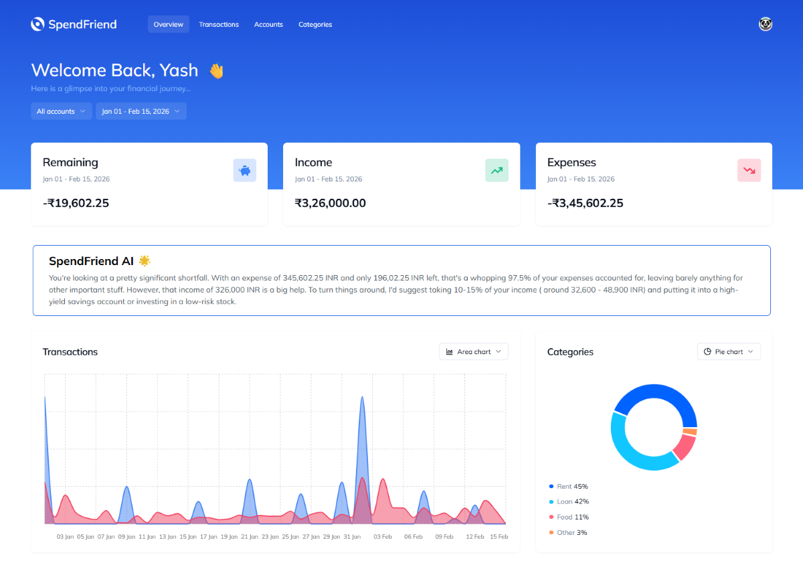

# 💰 SpendFriend AI



**SpendFriend AI** is an intelligent, high-performance personal finance management platform that combines traditional expense tracking with AI-powered insights. It serves as a comprehensive financial companion, offering real-time analytics, smart categorization, and personalized financial advice. Built with a focus on clean architecture, modern UI, and actionable intelligence.

> [!NOTE]
> This project was built following the [Build a Finance SaaS Platform With Nextjs, React, Honojs with CSV Upload (2024)](https://youtu.be/N_uNKAus0II?si=SQF0MrDr-FvKwQqq) tutorial by **Code With Antonio**. Huge credit to Antonio for the amazing educational content!

[](https://nextjs.org/)
[](https://reactjs.org/)
[](https://www.typescriptlang.org/)
[](https://tailwindcss.com/)
[](https://neon.tech/)
[](https://groq.com/)
[](https://clerk.com/)

---

## ✨ Features & Highlights

### 💳 Financial Management
- **Multi-Account Support**: Create and manage multiple accounts (Cash, Bank, Credit Card, etc.) with real-time balance tracking.
- **Smart Categorization**: Organize transactions with custom categories for better expense tracking and budgeting.
- **Transaction History**: Full CRUD operations with bulk import/export capabilities for seamless data management.
- **Date Range Filtering**: Dynamic filtering with intuitive date pickers to analyze specific time periods.
- **CSV Import**: Bulk import transactions with intelligent field mapping and validation.

### 🤖 AI-Powered Financial Insights
- **Smart Advisor**: Integrated AI assistant powered by **Groq (Llama 3.1 8B Instant)** providing personalized financial advice.
- **Context-Aware Analysis**: AI analyzes your income, expenses, and remaining balance to offer actionable suggestions.
- **Conversational Tone**: Friendly, casual advice that feels like chatting with a financially savvy friend.
- **Professional Guidance**: Specific recommendations on investments, savings, and expense optimization.

### 📊 Advanced Analytics & Visualization
- **Real-Time Dashboard**: Instant overview of financial health with income, expenses, and remaining balance cards.
- **Interactive Charts**: Area charts for trends, pie charts for category distribution using Recharts.
- **Comparative Analysis**: Compare current period performance with previous periods using percentage change indicators.
- **Visual Progress Tracking**: Beautiful progress indicators and trend arrows for quick financial health assessment.

### 🔐 Enterprise-Grade Security
- **Clerk Authentication**: Complete user management with OAuth support, session handling, and secure routing.
- **Data Isolation**: Complete user data separation ensuring privacy and security at the database level.
- **Protected Routes**: Middleware-based authentication protecting all sensitive routes and API endpoints.
- **Row-Level Security**: Database queries automatically filter by authenticated user ID.

### 🎨 Premium Design System
- **shadcn/ui Components**: Modern, accessible UI components built on Radix UI primitives.
- **Tailwind CSS**: Utility-first styling with custom color palette and design tokens.
- **Responsive Layout**: Fully responsive design optimized for desktop, tablet, and mobile devices.
- **Smooth Interactions**: Polished animations, hover states, and transitions for premium feel.
- **Dark Mode Ready**: Built-in theming support with HSL color system.

---

## 🛠 Tech Stack

### Frontend
- **Framework**: Next.js 14 (App Router, Server Components, Edge Runtime)
- **Language**: TypeScript 5.0 (Strict mode, type-safe development)
- **Styling**: Tailwind CSS v3.4 (Utility-first, custom design system)
- **UI Library**: shadcn/ui (Radix UI + Tailwind CSS)
- **State Management**: 
  - TanStack Query (React Query) - Server state synchronization
  - Zustand - Client state management
- **Form Handling**: React Hook Form with Zod validation
- **Charts**: Recharts (Composed charts, responsive containers)
- **Icons**: Lucide React + React Icons
- **Notifications**: Sonner (Toast notifications)
- **Animations**: Tailwind CSS animations + Custom transitions

### Backend
- **API Framework**: Hono (Lightweight, edge-optimized web framework)
- **Runtime**: Next.js Edge Runtime (Serverless, globally distributed)
- **Database**: Neon (Serverless PostgreSQL with connection pooling)
- **ORM**: Drizzle ORM (Type-safe SQL with relations)
- **Authentication**: Clerk (OAuth, JWT sessions, user management)
- **Validation**: Zod (Runtime schema validation)
- **AI Integration**: Groq SDK (Llama 3.1 8B Instant for financial insights)

### Development Tools
- **Package Manager**: npm
- **Linting**: ESLint (Next.js configuration)
- **Database Migrations**: Drizzle Kit
- **Type Safety**: TypeScript strict mode

---

## 📂 Project Structure

```text
spendfriend-ai/
├── app/                          # Next.js App Router
│   ├── (auth)/                   # Auth route group
│   │   ├── sign-in/[[...sign-in]]/
│   │   │   └── page.tsx          # Sign-in page
│   │   └── sign-up/[[...sign-up]]/
│   │       └── page.tsx          # Sign-up page
│   ├── (dashboard)/               # Protected dashboard routes
│   │   ├── accounts/             # Account management
│   │   │   ├── page.tsx
│   │   │   ├── columns.tsx
│   │   │   └── actions.tsx
│   │   ├── categories/           # Category management
│   │   │   ├── page.tsx
│   │   │   ├── columns.tsx
│   │   │   └── actions.tsx
│   │   ├── transactions/         # Transaction history
│   │   │   ├── page.tsx
│   │   │   ├── columns.tsx
│   │   │   ├── import-card.tsx
│   │   │   └── upload-button.tsx
│   │   ├── layout.tsx            # Dashboard layout
│   │   └── page.tsx              # Dashboard home
│   ├── api/[[...route]]/         # Hono API routes
│   │   ├── accounts.ts           # Accounts endpoints
│   │   ├── categories.ts         # Categories endpoints
│   │   ├── transactions.ts       # Transactions endpoints
│   │   ├── summary.ts            # Analytics endpoints
│   │   └── route.ts              # Main Hono app config
│   ├── layout.tsx                # Root layout
│   └── globals.css               # Global styles
├── components/                   # Shared UI components
│   ├── ui/                       # shadcn/ui components
│   │   ├── button.tsx
│   │   ├── dialog.tsx
│   │   ├── table.tsx
│   │   └── ...
│   ├── data-grid.tsx             # Dashboard stats cards
│   ├── data-charts.tsx           # Charts container
│   ├── data-ai.tsx               # AI insights component
│   ├── data-table.tsx            # Reusable data table
│   └── header.tsx                # App header
├── features/                     # Feature-based modules
│   ├── accounts/                 # Account feature
│   │   ├── api/                  # React Query hooks
│   │   │   ├── use-get-accounts.ts
│   │   │   ├── use-create-account.ts
│   │   │   ├── use-edit-account.ts
│   │   │   ├── use-delete-account.ts
│   │   │   └── use-bulk-delete-accounts.ts
│   │   ├── components/           # Feature components
│   │   │   ├── account-form.tsx
│   │   │   ├── new-account-sheet.tsx
│   │   │   └── edit-account-sheet.tsx
│   │   └── hooks/                # Feature hooks
│   │       ├── use-new-account.ts
│   │       └── use-open-account.ts
│   ├── categories/               # Category feature (same structure)
│   ├── transactions/             # Transaction feature (same structure)
│   └── summary/                  # Summary/analytics feature
│       └── api/
│           └── use-get-summary.ts
├── db/                           # Database configuration
│   ├── drizzle.ts                # Database client setup
│   └── schema.ts                 # Drizzle schema definitions
├── hooks/                        # Shared custom hooks
│   └── use-confirm.tsx           # Confirmation dialog hook
├── lib/                          # Utility functions
│   └── utils.ts                  # Helper utilities
├── providers/                    # React context providers
│   ├── query-provider.tsx        # TanStack Query provider
│   └── sheet-provider.tsx        # Sheet/Modal provider
├── scripts/                      # Database scripts
│   └── migrate.ts                # Migration runner
├── drizzle/                      # Migration files
│   └── meta/
├── next.config.mjs               # Next.js configuration
├── tailwind.config.ts            # Tailwind configuration
├── drizzle.config.ts             # Drizzle configuration
└── README.md                     # Documentation
```

---

## 🚀 Getting Started

### Prerequisites
- **Node.js**: v18.x or higher
- **npm**: v9.x or higher
- **Neon Database**: A Neon DB account (or any PostgreSQL instance)
- **Clerk Account**: For authentication (https://clerk.com/)
- **Groq API Key**: For AI features (https://console.groq.com/)

### Installation

1. **Clone the repository**:
   ```bash
   git clone https://github.com/yourusername/spendfriend-ai.git
   cd spendfriend-ai
   ```

2. **Install dependencies**:
   ```bash
   npm install
   ```

3. **Setup environment variables**:
   Create a `.env` file in the root directory:
   ```env
   # Database
   DATABASE_URL="postgresql://[user]:[password]@[host]:[port]/[dbname]"

   # Clerk Authentication
   NEXT_PUBLIC_CLERK_PUBLISHABLE_KEY="pk_test_..."
   CLERK_SECRET_KEY="sk_test_..."
   NEXT_PUBLIC_CLERK_SIGN_IN_URL=/sign-in
   NEXT_PUBLIC_CLERK_SIGN_UP_URL=/sign-up
   NEXT_PUBLIC_CLERK_AFTER_SIGN_IN_URL=/
   NEXT_PUBLIC_CLERK_AFTER_SIGN_UP_URL=/

   # Groq AI
   NEXT_PUBLIC_GROQ_API_KEY="gsk_..."
   ```

### Running the App

1. **Generate database migrations**:
   ```bash
   npm run db:generate
   ```

2. **Run migrations**:
   ```bash
   npm run db:migrate
   ```

3. **Start development server**:
   ```bash
   npm run dev
   ```

4. **Open Drizzle Studio** (optional, for database management):
   ```bash
   npm run db:studio
   ```

Access the app at `http://localhost:3000`. Sign in with Clerk to access the dashboard.

---

## 🧩 Detailed System Overview

### 💡 AI Intelligence Layer
The AI Assistant in `data-ai.tsx` is not just a wrapper. It uses a specialized system prompt that instructs Llama 3.1 8B Instant to act as a CASUAL financial friend. The AI:
- Analyzes remaining balance, income, and expenses
- Provides 65-word max evaluations
- Compares percentages to give context
- Offers specific investment/savings suggestions
- Avoids bullet points and verbose explanations
- Sends data in real-time via the summary API endpoint

### 🛡 Security Protocol
The `middleware.ts` acts as a gatekeeper for protected routes. The app uses Clerk's `clerkMiddleware` to:
- Protect the dashboard and all API routes
- Validate JWT tokens on every request
- Ensure user data isolation via `userId` checks in all queries
- Prevent unauthorized access to sensitive financial data

### ⚡ Performance & Caching
TanStack Query provides intelligent caching:
- Default stale time of 60 seconds
- Automatic background refetching
- Optimistic updates for mutations
- Query deduplication to prevent redundant requests
- Server state synchronization without prop drilling

### 🏗 Clean Architecture
The project follows feature-based modular architecture:
- **Feature encapsulation**: Each feature contains its own API, components, and hooks
- **Shared components**: UI primitives in `/components/ui`
- **Type safety**: End-to-end TypeScript with strict mode
- **Database relations**: Drizzle ORM handles complex relationships (accounts ↔ transactions ↔ categories)

---

## 🏗 Component Breakdown

### Core Components
- **Header**: Gradient background with logo, navigation, and user button
- **Navigation**: Responsive nav with active state indicators
- **DataGrid**: Three-card layout showing Remaining, Income, and Expenses with trend indicators
- **DataCharts**: Split view with area chart (trends) and pie chart (category distribution)
- **DataAI**: AI-powered insights box with Groq integration

### Feature Components
- **AccountForm**: Simple form for account name with validation
- **CategoryForm**: Category creation/editing with color support
- **TransactionForm**: Comprehensive form with date picker, account/category selects, amount input, and notes
- **DataTable**: Reusable table with sorting, filtering, pagination, and bulk actions

### Sheet Components
- **NewAccountSheet**: Slide-over for creating accounts
- **EditAccountSheet**: Slide-over for editing/deleting accounts
- **NewCategorySheet**: Slide-over for creating categories
- **EditCategorySheet**: Slide-over for editing/deleting categories
- **NewTransactionSheet**: Slide-over for creating transactions
- **EditTransactionSheet**: Slide-over for editing/deleting transactions

### Custom Hooks
- **useConfirm**: Promise-based confirmation dialog hook
- **useNewAccount**: Zustand store for new account sheet state
- **useOpenAccount**: Zustand store for edit account sheet state
- **useSelectAccount**: Custom hook for account selection modal

---

## 📡 API Reference

### 💳 Accounts Endpoint
| Method | Endpoint | Description |
|--------|----------|-------------|
| GET | `/api/accounts` | Fetch all user accounts |
| GET | `/api/accounts/:id` | Fetch account by ID |
| POST | `/api/accounts` | Create new account |
| POST | `/api/accounts/bulk-delete` | Bulk delete accounts |
| PATCH | `/api/accounts/:id` | Update account |
| DELETE | `/api/accounts/:id` | Delete account |

### 🏷️ Categories Endpoint
| Method | Endpoint | Description |
|--------|----------|-------------|
| GET | `/api/categories` | Fetch all user categories |
| GET | `/api/categories/:id` | Fetch category by ID |
| POST | `/api/categories` | Create new category |
| POST | `/api/categories/bulk-delete` | Bulk delete categories |
| PATCH | `/api/categories/:id` | Update category |
| DELETE | `/api/categories/:id` | Delete category |

### 📝 Transactions Endpoint
| Method | Endpoint | Description |
|--------|----------|-------------|
| GET | `/api/transactions` | Fetch all transactions (with date/account filters) |
| GET | `/api/transactions/:id` | Fetch transaction by ID |
| POST | `/api/transactions` | Create new transaction |
| POST | `/api/transactions/bulk-create` | Bulk import transactions |
| POST | `/api/transactions/bulk-delete` | Bulk delete transactions |
| PATCH | `/api/transactions/:id` | Update transaction |
| DELETE | `/api/transactions/:id` | Delete transaction |

### 📊 Summary Endpoint
| Method | Endpoint | Description |
|--------|----------|-------------|
| GET | `/api/summary` | Get financial summary with analytics |

**Query Parameters for Transactions & Summary:**
- `from` - Start date (YYYY-MM-DD)
- `to` - End date (YYYY-MM-DD)
- `accountId` - Filter by account ID

---

### ❤️ Developed By
### 👨‍💻 **Yash Thorat**

Feel free to suggest improvements, or report issues!

⭐ **Don't forget to star this repository if you find it useful!**
